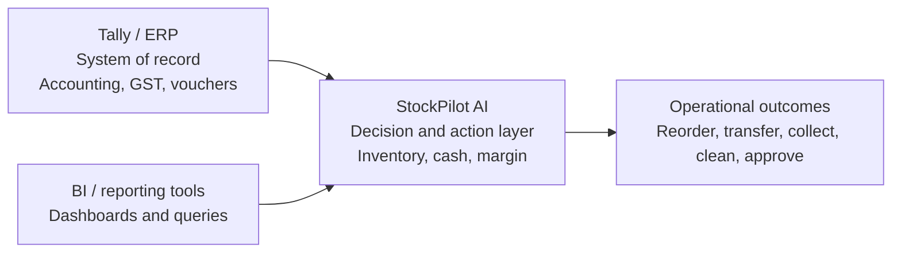

# StockPilot AI: Product Map, Roadmap, and Pitch Notes

## One-Line Pitch

StockPilot AI is an inventory and working-capital decision layer for businesses
that already use Tally, Excel, or another ERP.

## Product Promise

Connect Tally or Excel. Predict stockouts. Reduce dead stock. Improve profit.

## Simple Explanation

Tally remains the accounting and compliance system of record. StockPilot AI
uses exported business data to tell owners and teams what needs attention next:

- what to reorder;
- what may run out;
- where money is blocked in dead stock;
- why profit changed;
- which customer payment needs follow-up;
- which imported data needs review;
- what warehouse or sales staff should do today.

## Product Flow

## Product Capability Tree

```mermaid
flowchart TD
    SP["StockPilot AI"]

    SP --> CORE["Core Platform"]
    CORE --> AUTH["Authentication, tenant isolation, roles, audit"]
    CORE --> DATA["Canonical products, parties, warehouses, invoices"]
    CORE --> LEDGER["Stock ledger and financial projections"]
    CORE --> API["Spring Boot APIs, web dashboard, mobile app"]

    SP --> IMPORT["Smart Import"]
    IMPORT --> MULTI["Multi-file upload in any order"]
    IMPORT --> CLASSIFY["Automatic file classification and dependency plan"]
    IMPORT --> STAGE["Staging, validation, dry run, reconciliation"]
    IMPORT --> SAFE["Transactional and idempotent commit"]
    IMPORT --> REVIEW["Cashbook and uncertain-match review queue"]

    SP --> INTEL["Inventory Intelligence"]
    INTEL --> FORECAST["Demand forecast and stockout prediction"]
    INTEL --> REORDER["Reorder recommendations"]
    INTEL --> DEAD["Dead-stock action center"]
    INTEL --> PROFIT["Profit-change explanation"]
    INTEL --> QUALITY["Data quality and duplicate review"]

    SP --> ACTION["Action Workflows"]
    ACTION --> MOBILE["Mobile stock in, stock out, and transfer"]
    ACTION --> PORTAL["Dealer/customer ordering portal"]
    ACTION --> PAYMENT["Payment reminders and received-payment tracking"]
    ACTION --> REPORTS["Reports, exports, and audit trail"]
```

## What Is Working Today

Status: implemented in the current repository and suitable for MVP
demonstration, with production hardening still required.

### Platform and Security

- Java 21 and Spring Boot backend with PostgreSQL/Flyway.
- JWT login, BCrypt passwords, email verification, password reset, and optional
  Google sign-in.
- Multi-tenant business workspaces with Retail, Wholesale, and Hybrid modes.
- Permission-aware web navigation and backend permission checks.
- Audit logs for important business and security actions.
- Production configuration for Neon, Render, and Vercel.

### Inventory Core

- Products, categories, units, customers, suppliers, branches, and warehouses.
- Stock movement ledger as the inventory source of truth.
- Purchases increase stock and sales reduce stock.
- Warehouse transfers create paired out/in movements.
- Adjustments require a reason and respect the negative-stock policy.
- Dashboard calculations use real tenant data.

### Smart Import

- CSV, Excel, JSON, generic XML, and Tally XML support.
- Raw-file storage, staging tables, mapping, validation, preview, and commit.
- Multi-file Smart Import sessions accept files in any order.
- File classification, canonical staging, dependency planning, and dry run.
- Closing-stock reports use snapshot delta logic, so repeated imports do not
  double stock.
- Invoice-only Tally voucher posting prevents historical vouchers from
  duplicating a closing-stock snapshot.
- Financial credit/debit notes, outstanding snapshots, and cashbook matching.
- Manual review for unmatched cashbook payments with tenant-scoped candidates.
- Idempotency, fingerprints, reconciliation, retry, and safe undo support.

### Intelligence and Actions

- Low-stock alerts and demand forecasting.
- Stockout estimates and reorder suggestions with formula inputs.
- Dead-stock detection with blocked-capital actions.
- Rule-based, data-backed AI assistant and profit-change explanation.
- Product data-quality checks and duplicate review.
- Payment reminders and payment-received workflow.
- Dealer/customer ordering portal.
- Mobile product lookup, stock in/out, transfer, invoice upload, low stock, and
  reorder screens.
- Tenant-scoped CSV reports and an audit-log viewer.

## What Needs Strengthening

Status: meaningful implementation exists, but these areas need more work before
large-scale production use.

| Area | Current State | Needed Improvement |
| --- | --- | --- |
| Permissions | Role and permission catalog exists | Database-managed custom roles, user invitation, assignment UI, branch/warehouse scope |
| Smart Import | Broad and operational | More anonymized real Tally fixtures, clearer bulk review, connector monitoring |
| Forecasting | Practical rule-based model | Backtesting, confidence bands, seasonality, promotions, supplier reliability |
| Profit intelligence | Uses known invoice and cost data | True margin waterfall, discount/return/freight attribution, supplier variance |
| AI assistant | Local, deterministic answers | Evidence panel, metric lineage, optional guarded LLM explanations |
| Mobile | Core warehouse screens exist | Physical-device QA, camera barcode reliability, offline queue and conflict handling |
| Dealer portal | Catalog/order/outstanding basics | Approval, delivery tracking, credit controls, notifications |
| Production operations | Render/Vercel/Neon configuration exists | Observability, backups, object storage, malware scanning, rate limits, load tests |
| Tests | Unit and integration coverage exists | Broader permission matrix, import fixture matrix, concurrency and production smoke tests |

## Recommended Next Release

Focus: turn the MVP into a dependable pilot product for wholesalers and
distributors.

1. Add a live, read-only Tally connector with scheduled incremental sync.
2. Add evidence and data lineage to every AI answer and dashboard metric.
3. Create a deterministic metric registry for stock, margin, receivables, and
   working-capital definitions.
4. Add user invitations, role assignment, branch/warehouse access, and approval
   rules.
5. Add import health monitoring, bulk review tools, and a larger real-world
   Tally fixture suite.
6. Add forecast backtesting, confidence, supplier lead-time reliability, and
   cross-warehouse transfer recommendations.
7. Add scheduled alerts for stockout, dead stock, margin drop, overdue payment,
   and failed imports.
8. Add production storage, backup/restore drills, observability, rate limiting,
   and security testing.

## Roadmap

```mermaid
timeline
    title StockPilot AI Product Roadmap
    Now - Working MVP
        Inventory ledger and operational dashboard
        Tally and multi-file Smart Import
        Forecast, reorder, dead stock, and profit insights
        Web, mobile, dealer portal, payments, reports, audit
    Next - Pilot Ready
        Evidence and metric lineage
        Live read-only Tally sync
        User invitations, scoped roles, approvals
        Import monitoring and real-customer fixture hardening
        Backtested forecasts and proactive alerts
    Later - Scale
        Multi-company command center
        Cross-warehouse optimization
        Supplier collaboration and procurement workflow
        Connector SDK and partner ecosystem
        Outcome tracking and benchmark intelligence
    Future - Capability Packs
        Manufacturing and BOM intelligence
        Project inventory and project profitability
        CRM and custom database intelligence
        Controlled ERP write-back with approval
```

## Future Capability Packs

### 1. Trading and Distribution

This should remain the first commercial focus.

- supplier reliability and price-change intelligence;
- automated purchase proposal and approval;
- dealer ordering and credit controls;
- cross-warehouse stock balancing;
- fill-rate and lost-sales measurement.

### 2. Manufacturing

Build only after the trading core is stable.

- bill of materials;
- production orders;
- raw material and finished-goods planning;
- work in progress;
- yield, scrap, and batch traceability;
- purchase order, goods receipt, and invoice matching.

### 3. Project Inventory

Useful for construction, contractors, and real estate operations.

- project/site dimension;
- material issue and return by project;
- project budgets and procurement;
- contractor bills, retention, and project cash flow;
- project profitability.

This should support operations, not become a statutory filing system.

### 4. CRM and Custom Data Intelligence

- schema discovery for customer databases and APIs;
- customer risk, repeat buying, churn, and credit patterns;
- unified customer/product intelligence across ERP and CRM;
- reusable connector SDK.

## Competitive Positioning

StockPilot AI should not compete by rebuilding accounting, GST, statutory
reports, or every ERP screen. Its advantage should be:

- reliable ingestion of imperfect business data;
- trustworthy inventory and payment reconciliation;
- explainable recommendations;
- clear approvals and action workflows;
- web, mobile, and dealer experiences around the same tenant data.

## What Not To Build Yet

- a full Tally replacement;
- GST filing or statutory compliance engine;
- unrestricted text-to-SQL against production databases;
- automatic product merges without confirmation;
- uncontrolled write-back into Tally or another ERP;
- hundreds of shallow connectors before the core data model is stable;
- manufacturing and real-estate modules before the distribution pilot works.

## Simple Demo Story

1. Sign in as a business owner.
2. Upload Tally exports together in Smart Import.
3. Show automatic classification, staging, validation, and reconciliation.
4. Explain that closing stock is a snapshot and cannot double stock.
5. Open the dashboard and show current stock, sales, profit, receivables, and
   today's actions.
6. Open forecasts and explain one reorder recommendation.
7. Open dead stock and show blocked capital plus a suggested action.
8. Ask the AI assistant why profit changed and show its evidence.
9. Create a payment reminder and record a received payment.
10. Show the warehouse mobile workflow and dealer portal.

## Two-Minute Pitch Script

Most small distributors already have valuable data in Tally or Excel. The
problem is that those systems tell them what happened, while many daily
inventory and cash decisions still depend on spreadsheets, calls, and
experience.

StockPilot AI works beside the accounting system. A business uploads or
connects its Tally and Excel data. StockPilot stages and validates it, builds a
trusted stock ledger, and then shows what needs action: products likely to
stock out, items blocking money, purchase quantities to reorder, customers to
follow up for payment, and the reasons profit changed.

The MVP already includes a Spring Boot backend, a responsive web application,
an Expo mobile app, multi-tenant security, Smart Import, forecasting,
dead-stock and profit insights, a dealer portal, payment workflows, reports,
and audit logs.

The next step is to make it pilot-ready: live read-only Tally sync, evidence
behind every number, stronger roles and approvals, backtested forecasts,
proactive alerts, and production monitoring.

The long-term opportunity is a modular operating intelligence platform for
trading and distribution first, then manufacturing, project inventory, and
custom CRM data. StockPilot does not replace the customer's ERP. It makes the
data inside that ERP useful for the next decision.

## Pilot Ask

The strongest next milestone is a focused pilot with 3 to 5 distributors that:

- use Tally and Excel today;
- operate one or more warehouses;
- have at least 12 months of sales and purchase history;
- face stockouts, dead stock, or overdue receivables;
- can review recommendations weekly with the product team.

Measure:

- fewer stockout days;
- lower dead-stock value;
- improved inventory turns;
- faster receivable follow-up;
- recommendation acceptance and outcome;
- import accuracy and time saved.

Do not promise a financial result before a controlled pilot measures it.
