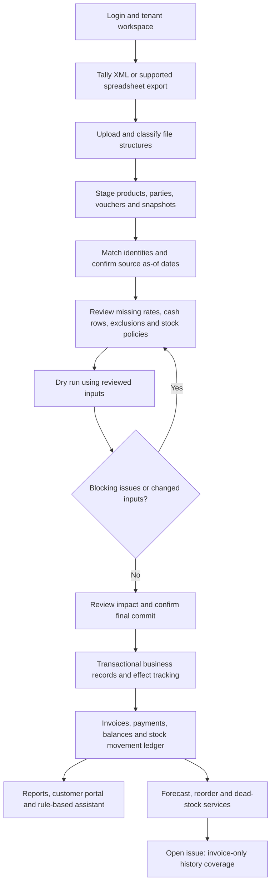
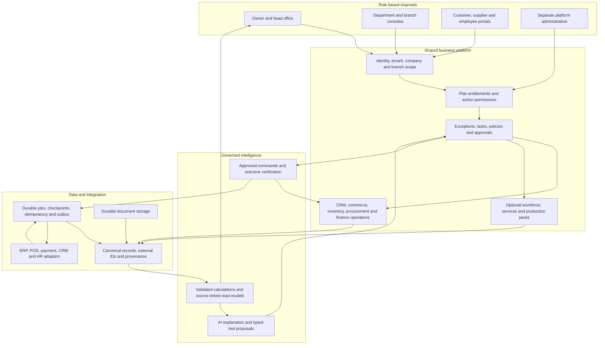
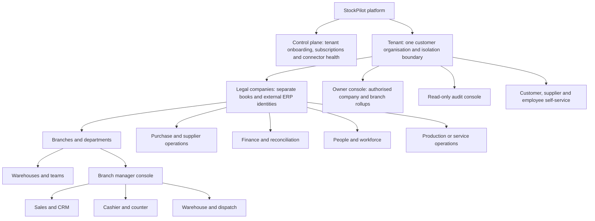
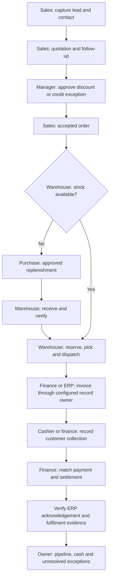
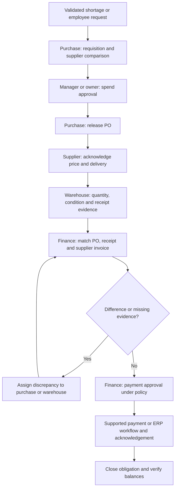
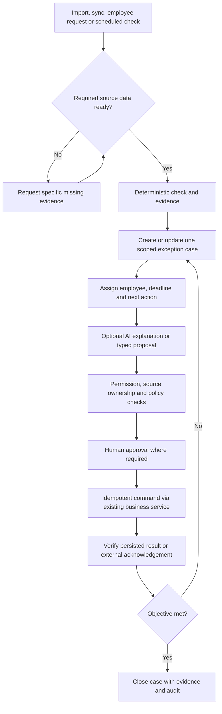
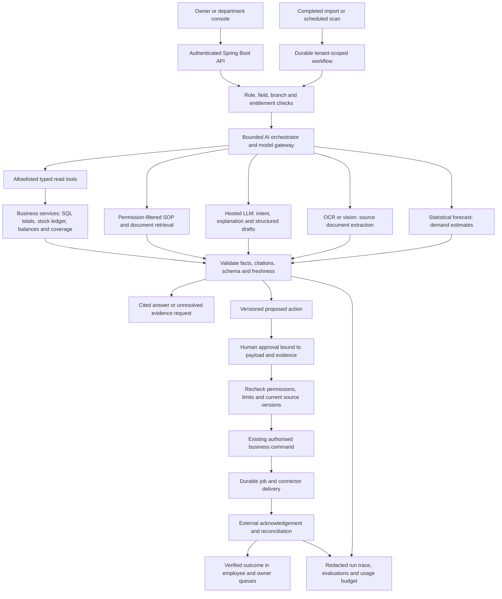
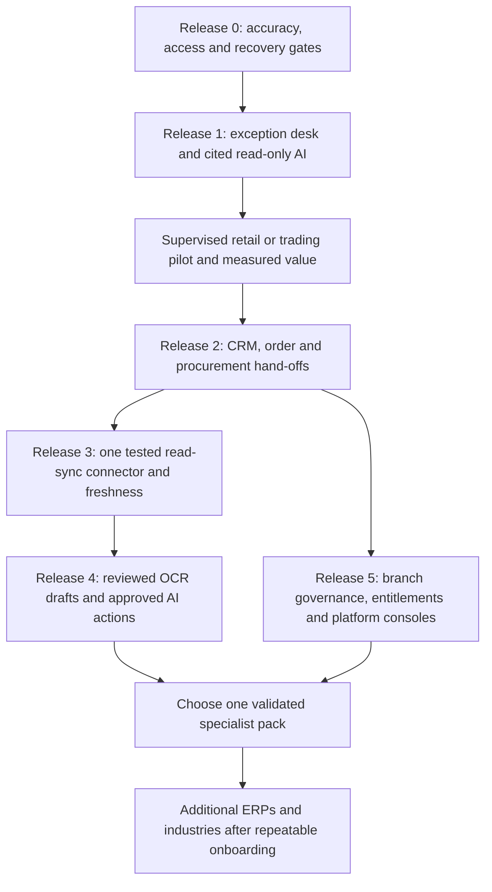

# StockPilot Business Platform Blueprint

Assessment date: 9 October 2026. Audience: founder, implementation team and pilot customers.

AI architecture revision: 18 October 2026. Model services and workflows below are proposed; this revision does not activate a live provider.

## Product Direction

Build a modular business operations platform around StockPilot's existing import and inventory foundation. A business keeps its accounting ERP, connects the additional tools it uses, and gives each employee a scoped workspace. StockPilot turns reliable data into assigned work, approvals and verified outcomes; the owner sees the result across departments.

AI belongs inside that work: explain a cash difference, extract a supplier bill, prepare a collection follow-up, or turn a verified shortage into a purchase draft. Each department uses the same governed model services through its own console. The model interprets and proposes; business services calculate, permissions constrain, staff approve consequential actions, and connectors verify the result.

The first paid offer should serve retailers, traders and small distributors using Tally. Extend to another ERP or industry after demonstrating one complete, repeatable workflow with paying customers. A broad module catalogue is a long-term architecture, not a reason to delay the first useful release.

Suggested pitch after pilot validation: **StockPilot connects your business data, shows what needs attention, assigns the next step to the right person, and tracks whether it was resolved. Your existing ERP stays in place.**

There are two operating modes. In connected mode, the ERP remains authoritative for accounting and, where configured, inventory. In StockPilot-managed operations mode, StockPilot owns selected operational records such as CRM, orders or itemized stock activity. Record ownership must be configured explicitly; both systems must not independently post the same sale or stock change.

## Current Product

Present means a code path exists in this repository. It does not mean live deployment, every permission, every data format or the complete workflow has been certified. This design task does not change application code or re-run the application regression suite.

| Capability | Current state | Important boundary |
| --- | --- | --- |
| Accounts and workspaces | JWT authentication, tenant membership, roles and permission catalogue | Scoped company/branch roles and sensitive-field controls need further work |
| Business modes | Retail, wholesale and hybrid enums | Manufacturing and services are not implemented business packs |
| Organisation | Tenant, simple Branch and Warehouse entities | Not yet a complete legal-company hierarchy, branch administration or branch-scoped access model |
| Data onboarding | Tally mixed masters/vouchers, stock snapshots, party balances; spreadsheet/XML import paths | Supported structures need fixtures and reconciliation; not every ERP export is supported |
| Import safeguards | Staging, matching, review resolutions, exclusions, confirmed snapshot dates, dry run and final commit | Interrupted-commit recovery remains a launch blocker |
| Inventory | Products, units/conversions, warehouses, movement ledger and snapshot baselines | Snapshots establish stock at their date; they do not reveal missing item-level sales |
| Transactions | Sales/purchases, customer/supplier balances and payments, financial notes, guarded returns/transfers | Not a complete general ledger, statutory accounting or manufacturing engine |
| Unitemized retail sales | Confirmed amount-only retail totals with source/duplicate controls | Stock, product demand, cost and margin cannot be reconstructed from total cash/UPI |
| Orders and customer portal | Sales/purchase order entities, reorder draft paths and customer portal | Full CRM, fulfilment orchestration and supplier portal are not demonstrated end to end |
| Reports and intelligence | Dashboard, forecasts, reorder, dead stock, data quality, profit insights and CSV exports | Invoice-only demand coverage and some cost calculations remain open audit issues |
| AI | Keyword-based evidence selection and stored conversations | LLM provider is a placeholder; configured values do not cause a model request |
| Owner actions | Generated action cards and recorded reminder/action paths | Not yet a durable assignment, approval, execution and verification system |
| OCR and sync | Integration/provider foundations | Real OCR unavailable; continuous ERP sync and approved write-back are not established |
| Consoles | Shared permission-filtered web shell, customer portal and mobile codebase | Role names alone do not create complete department/platform consoles |
| Infrastructure | Spring Boot, Next.js, Expo, PostgreSQL; compose lists Redis, RabbitMQ and MinIO | Listing an infrastructure service does not prove a durable production job/file pipeline |

### Current Flow



In hybrid imports, historical invoices must not generate extra stock movements already represented by the closing snapshot. Analytics must read normalized, deduplicated sales history separately from the stock ledger. Correcting analytics by adding artificial stock movements would corrupt inventory.

### Evidence Anchors

- [Roles and business modes](../backend/src/main/java/com/stockpilot/ai/domain/DomainEnums.java).
- [Permission catalogue and role mappings](../backend/src/main/java/com/stockpilot/ai/service/PermissionService.java).
- [Shared web shell](../web/components/AppShell.tsx).
- [Branch foundation](../backend/src/main/java/com/stockpilot/ai/domain/Branch.java), [warehouse foundation](../backend/src/main/java/com/stockpilot/ai/domain/Warehouse.java) and [membership shape](../backend/src/main/java/com/stockpilot/ai/domain/UserTenantMembership.java).
- [Source date checks](../backend/src/main/java/com/stockpilot/ai/service/SmartImportSnapshotDateService.java).
- [Retail totals](../backend/src/main/java/com/stockpilot/ai/service/RetailCounterSaleService.java).
- [Owner action cards](../backend/src/main/java/com/stockpilot/ai/service/OwnerActionService.java), [assistant](../backend/src/main/java/com/stockpilot/ai/service/AiAssistantService.java) and [LLM placeholder](../backend/src/main/java/com/stockpilot/ai/service/LlmAiProvider.java).
- [Launch audit with current finding status](LAUNCH_READINESS_REVIEW.md) and [previous fix evidence](AUDIT_FIXES_2026-10-05.md).
- [Earlier agentic architecture](AGENTIC_OPERATIONS_ARCHITECTURE.md).

## Why a Customer Would Buy

Architecture enables value; it does not prove demand. The purchase decision should rest on measurable problems that the customer's current tools do not already solve well.

| Customer problem | StockPilot workflow | Evidence of value |
| --- | --- | --- |
| Owner switches between accounts, stock and staff messages | One source-linked owner view with assigned exceptions | Less time preparing daily decisions; fewer unowned issues |
| Cash/UPI totals and accounts do not reconcile | Evidence-based collection classification and settlement review | Reduced unresolved differences without double counting sales |
| Stock differs from records | Dated reconciliation case, assigned cycle count and approved correction | Time to explain and resolve a variance; verified counts |
| Customer follow-up depends on memory | CRM activities, actual due-date evidence, collection tasks and outcome tracking | Follow-ups completed; collections measured against a baseline |
| Purchases happen without coordination | Requisition, approval, PO, receipt and invoice matching | Fewer duplicate/incorrect orders and faster verified receiving |
| Staff do not know what to do next | Personal queue with owner, deadline and hand-off | Less chasing; fewer overdue tasks and missed hand-offs |
| Bills require repeated typing | OCR draft, review, duplicate check and controlled ERP delivery | Time saved per verified bill and extraction error rate |

The first differentiated experience should be an **Inventory and Cash Exception Desk**. Show what is known, what is missing, who is responsible, the supporting records and the next permitted action. Add CRM and departmental workflows around that common engine.

## Lessons From the Reference Images

The four supplied CaratOS screenshots are UI inspiration, not proof of integration capabilities or backend completeness.

| Visible pattern | Adaptation for StockPilot | Scope choice |
| --- | --- | --- |
| Grouped department navigation | Show subscribed modules and permitted work, plus a personal queue | Do not display every module to every employee |
| Connector catalogue | Each connector shows supported records, direction, latest success, data coverage and errors | A connector is available only after its adapter and tests exist |
| Store setup and activation checklist | Require branch identity, company mapping, assigned manager and enabled warehouse | Region/geofence only where the customer's process needs them |
| Head-office and store view | Owner-wide rollups; managers see assigned branches | Verify scope on the server, including reports and AI tools |
| HRMS, shifts and weekly off | Optional workforce module or integrated HR provider | Geolocation attendance must have a defined purpose and privacy controls |
| Approvals and morning digest | Shared approval queue and evidence-backed daily briefing | Show data-as-of and unresolved inputs; do not imply live data |

## Future Architecture

Keep the current modular Spring Boot application and shared Next.js experience. Add clear module ownership and typed interfaces before considering service separation.



The owner screen reads cross-module projections; it must not independently recalculate balances, valuation or permissions. Every metric carries company/branch, period, currency, source, coverage and calculation version. Unknown and stale are distinct from zero.

### Organisation and Consoles



Legal companies are not interchangeable with branches. Do not combine financial books or currencies into an unexplained total. Reuse the existing Branch entity where suitable, while introducing the missing company and scope relationships through new migrations.

| Console | Primary work | Visibility and approval boundary |
| --- | --- | --- |
| Platform super admin | Tenant provisioning, module catalogue, lifecycle and platform health | No automatic access to customer financial records |
| Platform billing admin | StockPilot subscriptions, usage and subscription invoices | Business invoices and staff information remain outside this role |
| Platform support | Connector diagnostics and approved support sessions | Customer-granted, purpose-limited, expiring access with audit |
| Business owner | Business health, exceptions, approvals, pipeline and department outcomes | All authorised company/branch data; no fabricated profit/ROI |
| Business administrator | Users, scopes, branches, connectors and configuration | Administrative access does not automatically grant financial detail |
| Branch manager | Local stock, orders, cash closing, targets, queues and threshold approvals | Assigned branches; escalation above approved limits |
| Sales and CRM | Leads, contacts, activities, quotations, orders and customer follow-up | Assigned accounts/territory; costs/margins require explicit permissions |
| Cashier | Itemized sale capture, approved retail totals, tender collection and shift closing | Own register/branch; cannot silently reclassify transfers as revenue |
| Warehouse and dispatch | Receiving, counts, picking, packing, transfers and proof of delivery | Stock quantities in assigned warehouses; costs separately permitted |
| Purchase manager | Requisitions, RFQs, supplier comparison, POs and shortages | Approved spend limits; separate payment approval |
| Finance/accountant | Receivables/payables, matching, bill verification, adjustments and ERP posting status | Authorised financial records; maker/checker rules for sensitive changes |
| HR/people manager | Employees, shifts, attendance, leave and payroll-provider hand-off | Sensitive employee data restricted to justified roles |
| Production manager | BOM versions, planned orders, material issues, output, QA and scrap | Manufacturing pack; controlled release and costing |
| Service/team coordinator | Appointments, tickets, projects, work orders, timesheets and SLA | Service pack and assigned customers/teams |
| Marketing | Consented campaigns, lead sources, segments and attribution | Permissioned contact data and external messaging provider |
| Employee | Own tasks, attendance, leave and assigned activity | Own records; no department-wide financial or HR visibility |
| Auditor | Approved records, versions, approvals, source evidence and exports | Read-only and scoped; export rights explicit |
| Customer | Own quotations/orders, fulfilment status, permitted invoices and balances | Customer identity bound to tenant-owned records |
| Supplier | Own PO acknowledgement, delivery notices and document submission | No competitor terms or internal purchase approvals |

Existing owner/admin/staff/customer/platform role constants should be extended conservatively. Full consoles, branch scopes, supplier identity bindings and financial field restrictions still require implementation.

### Access and Subscriptions

An operation is permitted only when all applicable checks pass:

```text
active tenant and membership
  AND subscribed module
  AND role/action permission
  AND legal-company/branch/warehouse scope
  AND record and sensitive-field visibility
  AND valid workflow state and approval policy
```

Apply this rule on APIs, exports, background workers, notifications, portals and AI retrieval. Hiding navigation is insufficient. A subscription to CRM does not give every employee access to every customer. Delegated AI actions retain the initiating user's scope and recheck it at execution.

Separate console families can share one web codebase and design system. Proposed routes: `/owner`, `/work`, `/crm`, `/commerce`, `/inventory`, `/procurement`, `/finance`, `/people`, `/production`, `/service`, `/admin`, `/portal/customer`, `/portal/supplier`, `/self-service` and `/platform`. Preserve existing routes during migration with reviewed compatibility redirects.

## Module Catalogue

| Module | Main capability | Recommended ownership |
| --- | --- | --- |
| Platform core | Identity, scopes, configuration, audit, plans and usage | Build shared core; integrate payment collection for SaaS billing |
| Data operations | Imports, mappings, source dates, quality and connector health | Extend existing import pipeline |
| Work and approvals | Cases, tasks, assignment, deadlines, policy, evidence and verification | Build once for all departments |
| Inventory | Catalog, units, warehouses, counts, reservations and movements | Extend existing ledger and reconciliation services |
| CRM | Leads, contacts, opportunities, activities, quotations and collection follow-up | Build small workflow; support an existing CRM connector later |
| Commerce | Orders, fulfilment, counter capture, returns and delivery tracking | Extend existing orders; integrate POS/e-commerce where already used |
| Procurement | Requisition, RFQ, PO, supplier acknowledgement, receiving and matching | Extend POs, suppliers and reorder foundations |
| Finance operations | Operational receivables/payables, collections, cash/UPI settlement and bill review | Reuse shared calculations; ERP owns statutory books initially |
| People | Team, shifts, attendance, leave, targets and task accountability | Lightweight operations; integrate established payroll/HR systems |
| Services | Tickets, appointments, projects, work orders and time/service tracking | Optional pack after customer discovery |
| Production | BOM, routing, production orders, material/WIP, QA and scrap | Optional manufacturing pack; not a renamed stock journal |
| Marketing | Consent, lead attribution, campaign tasks and outcomes | Integrate messaging/campaign providers; do not invent a delivery network |
| Intelligence | Owner 360, validated insight services, OCR drafts and governed AI tools | Shared evidence/permission layer and usage budgets |

Security, correct dates, truthful calculations, audit and customer data export belong in every plan. Integration fees, capacity and specialist workflows can differ by plan.

## End to End Workflows

### Lead to Cash



A lead is not a customer sale. An order is not revenue. An invoice is not proof of payment. A UPI collection is not proof of bank settlement. Each state has evidence and a clear owner. Amount-only historical retail totals remain separate from itemized orders and stock-based margin calculations.

### Procure to Pay



AI may explain a difference or draft a request. It must not mark a bill paid merely because a recommendation was approved. Partial receipts, partial payments, credits, reversals and cancellations are first-class states.

### Common Exception and AI Workflow



Examples: a negative-stock case assigns a physical count; a cash mismatch requests tender/settlement evidence; a collection task uses actual invoice due dates when available. The owner can ask an agent to prepare a plan for all unresolved branch cash differences, but success is measured by verified reconciliations, not messages generated.

### Bill Capture to ERP

1. Employee uploads a photo/PDF to durable storage with tenant and document access scope.
2. OCR returns extracted fields, line items, source regions and confidence; handwritten documents may need substantial review.
3. Validate totals, tax treatment, currency, supplier identity, units and duplicate document identity.
4. Reviewer confirms evidence or corrects the draft; do not invent missing prices or products.
5. Apply PO/receipt matching and maker/checker approval where configured.
6. Deliver through a tested ERP adapter or create a reviewed export if write-back is unsupported.
7. Store acknowledgement, external ID, retry state and reconciliation result. Show separately approved, delivered and posted.

### People and Production

People workflow: branch team setup -> assigned shift -> attendance event -> manager regularisation -> approved leave/time summary -> payroll-provider export -> provider acknowledgement. Employee consent/access and retention must be designed before collecting location or sensitive HR data.

Manufacturing workflow: versioned BOM/routing -> demand/order -> material availability -> approved production release -> material issue and WIP -> output/scrap capture -> quality acceptance -> finished goods -> cost reconciliation with ERP. Add batch/serial and subcontracting only when the chosen manufacturers need them. A stock snapshot cannot establish production yield or exact WIP cost.

## Data and Technical Structure

### Keep and Extend

Keep Spring Boot 3/Java 21, Next.js, Expo and PostgreSQL. Organise new code around bounded modules, retaining existing public APIs during incremental migration. Use new Flyway migrations; do not alter applied ones. No production-data repair belongs in the architecture rollout.

| Boundary | Suggested records or services | Invariant |
| --- | --- | --- |
| Organisation | LegalCompany, existing Branch/Warehouse, scoped RoleAssignment | Every business query belongs to tenant and authorised scope |
| Entitlements | ModuleDefinition, PlanVersion, Subscription, TenantEntitlement, UsageLimit | Backend enforces access; plan changes preserve customer records |
| Work | ExceptionCase, Task, Assignment, Comment, EvidenceLink | Stable issue identity; repeated scans update rather than duplicate |
| Approval | ActionProposal, ApprovalRequest, ApprovalDecision, PolicyVersion | Approved exact inputs/data version; stale approvals require review |
| CRM | Lead, Contact, Opportunity, Activity, Quote | Existing Customer remains party identity; do not duplicate receivables |
| Operations | Existing sales/PO/invoice records plus reservation, receipt and fulfilment records | Explicit source of truth; no duplicate invoice/stock posting |
| Integration | ConnectorInstance, Capability, SourceCoverage, SyncCheckpoint, DeliveryAttempt | External identity includes tenant, source/company and source key |
| Jobs | Job, JobStep, Lease, Retry, IdempotencyKey, OutboxEvent | Recovery cannot repeat committed effects |
| Documents | DocumentAsset, ExtractionDraft, FieldEvidence, RetentionRule | Source preserved; approved output linked to original |
| Intelligence | ReadinessResult, CalculationVersion, Insight, AgentRun, ToolInvocation | Evidence is permission-scoped before model access |

This is a conceptual data model, not an instruction to create all tables immediately. Introduce each record with the first workflow that uses it. Existing party aliases/GSTIN mappings, conversion rules and import effects must be preserved.

Use PostgreSQL transactions for business commands and an outbox for durable downstream delivery. Initially a database-backed job worker is sufficient if it meets capacity needs. RabbitMQ can dispatch work when justified; it does not replace durable job state, leases or idempotency. Store uploads in durable object storage with scoped access and retention. Avoid adding Kafka, a vector database or multiple AI models before a concrete requirement.

### Integration and Record Ownership

| Data | Initial authoritative source | StockPilot role |
| --- | --- | --- |
| Posted accounts, tax and accounting documents | Customer ERP | Read, reconcile, explain and request controlled posting |
| Inventory in connected mode | ERP stock ledger/snapshots under an explicit cutoff policy | Mirror reconciled quantities; prevent double application |
| StockPilot-managed operational inventory | StockPilot movement ledger | Execute authorised activity and export/deliver under policy |
| Leads, work assignments and approval evidence | StockPilot or selected existing CRM/workflow tool | Own only the configured records and relationships |
| Bank settlement and payment delivery | Bank/payment provider | Match and show acknowledgement; do not infer settlement |
| Payroll and statutory HR calculations | Selected payroll/HR system | Provide approved operational attendance inputs |

Start with a one-way, read-only Tally connector, alongside existing import fallback. A local agent reads explicitly selected companies and sends outbound authenticated TLS traffic; it should not expose the Tally/SQL port to the internet. Store device/company mapping, last successful sync, checkpoint, source coverage, retries and reconciliation status. Pair each device with limited, revocable credentials. Only advertise tested record types.

For cloud ERP/CRM/POS APIs, handle authenticated scopes, pagination, rate limits, signed webhooks where available, deduplication, out-of-order changes and deleted/cancelled records. API access may depend on the customer's ERP edition/subscription: for example, Odoo documents external API access under its Custom plan. Verify licence and supported APIs before promising a connector. [Odoo pricing](https://www.odoo.com/pricing), [Odoo external API documentation](https://www.odoo.com/documentation/18.0/developer/reference/external_api.html).

Write-back is a later capability per connector and record type. Use exact approved payloads, external idempotency/source identity, acknowledgement and retry/reconciliation states. Never label a StockPilot draft or export as already posted in the ERP.

### Governed AI

Use deterministic Java/SQL services for money, quantities, demand, dates and reconciliation. Use a model for language interpretation, document extraction, evidence explanation and draft plans. A small set of tested tools is more useful than a different model for each department.

Read tools can include source coverage, customer balance, order status, stock reconciliation and supplier comparison. Write tools can later propose a task, draft a PO or request an approved adjustment. Enforce structured arguments, tenant/scope, entitlement, allowed state and approvals outside the model. Never allow arbitrary SQL, unrestricted ERP credentials or a prompt to bypass policy.

Start with read/explain; then draft; then approved execution. Limited automatic execution is only appropriate for narrowly tested, reversible, low-risk actions under an explicit customer policy. Treat uploaded text as evidence, not as agent instructions. Persist prompt/tool/calculation versions, bounded retries, usage/cost and outcome evidence. Maintain per-tenant AI/OCR quotas and evaluation fixtures for misleading sources, missing data, forbidden fields and duplicate execution.

### Where AI Runs



The arrows describe data and control dependencies, not permission for the LLM to run arbitrary code. A proposed tool call is an untrusted request that Spring Boot must authorise and validate. Event-triggered runs use an explicit service identity and scope; they do not inherit unrestricted owner access. No connector credentials or provider keys go to Next.js or the model prompt.

### Current AI Versus Proposed Models

The current [assistant service](../backend/src/main/java/com/stockpilot/ai/service/AiAssistantService.java) chooses evidence using keyword branches. [LlmAiProvider](../backend/src/main/java/com/stockpilot/ai/service/LlmAiProvider.java) returns placeholder text even when endpoint and key are supplied; there is no outbound model request in that implementation. [ForecastMath](../backend/src/main/java/com/stockpilot/ai/service/ForecastMath.java) contains deterministic averages and reorder calculations, not a trained LLM. These are useful foundations, but they do not establish the proposed model gateway or autonomous workflows.

| Component | Job in StockPilot | Initial decision |
| --- | --- | --- |
| Tool-capable general LLM | Interpret a question, select permitted evidence tools, explain results, produce schema-constrained drafts | Evaluate one hosted provider first; Gemini Flash family is a candidate, not a selected production dependency |
| Stronger reasoning LLM | Investigate complex multi-record exceptions and draft a supported causal hypothesis | Add only if a representative evaluation beats the initial model enough to justify latency and cost; still verify every claim |
| OCR / document model | Extract bill headers, lines, page locations and uncertain fields | Evaluate Azure Document Intelligence invoice extraction on actual printed and handwritten samples; use reviewed vision fallback where useful |
| Embedding model and retrieval | Find relevant passages in permitted manuals, contracts and SOPs | Later, when document search is needed; embeddings are not the balance database and need not be in the first pilot |
| Statistical demand model | Estimate future item demand and uncertainty | First repair and validate the existing baseline; compare seasonal/intermittent-demand candidates on held-out periods before introducing a model service |
| Rules and matching engine | Calculate tax/money/units, enforce stock policy, detect duplicates, reconcile references | Remain deterministic business code, outside the LLM |

Gemini documents tool calling and schema-constrained structured output; these establish candidate integration mechanisms, not factual accuracy or business authorisation. Pin a supported model version after evaluating it with StockPilot fixtures. [Function calling](https://ai.google.dev/gemini-api/docs/function-calling), [Structured outputs](https://ai.google.dev/gemini-api/docs/structured-output).

Azure's invoice model extracts invoice fields and line items from supported documents. Suitability for each customer's handwriting, language and layout must be measured; unreadable fields remain unresolved rather than filled with guesses. [Invoice model documentation](https://learn.microsoft.com/en-us/azure/ai-services/document-intelligence/prebuilt/invoice?view=doc-intel-4.0.0).

Do not buy a separate model for every department. Start with one backend LLM API integration, add a document provider when bill intake is built, and retain Java calculations. API usage is metered separately from any consumer chat subscription. Keep provider/model IDs configurable server-side and use narrow internal adapters so a provider change does not rewrite business workflows. Self-hosting or fine-tuning should follow a demonstrated privacy, cost or quality requirement, not precede the first customer evaluation.

### AI Workflows Customers Can Value

| Workflow and console | Model contribution | Evidence and deterministic work | Human decision and verified result |
| --- | --- | --- | --- |
| Owner morning briefing | Summarise current exceptions and explain changes in plain language | Scoped service totals, source dates, coverage and ranking rules | Owner delegates a case; progress is recorded until evidence confirms resolution |
| Inventory and purchasing | Explain shortage drivers and draft PO lines from an approved recommendation | Item-level sales, lead time, open POs, units, MOQ, budget and demand forecast | Buyer verifies, manager approves, supplier acknowledgement and goods receipt establish the outcome |
| Cash and UPI closing | Explain possible unmatched receipts, settlement delays or fees | Tender records, cash counts, bank evidence and deterministic matching | Accountant confirms a match or requests evidence; never convert all receipts into sales automatically |
| Supplier bill intake | OCR plus vision/LLM maps extracted lines to candidate suppliers and products | Source page references, totals, dates, duplicate identity, PO/receipt comparisons | Reviewer confirms uncertain fields; approved connector delivery is complete only after ERP acknowledgement |
| CRM and collections | Summarise customer activity and draft a relevant follow-up | Verified due balances, communication permissions, activity and promises | Staff approves recipient/message; later settlement is independently verified |
| Manufacturing, later | Explain material/yield variance and propose an investigation | Versioned BOM, issue/output/scrap/QA and deterministic production calculations | Production manager approves a corrective task; source records establish closure |
| Services, later | Classify a ticket, retrieve relevant SOPs and draft assignment | Skills, availability, SLA, parts and permitted customer history | Coordinator approves, technician supplies completion evidence, finance receives billing hand-off |

For example, an owner asks why stock is negative. StockPilot retrieves the dated snapshot and item movements it is permitted to show. Java reconciles the known quantities. The LLM explains the discrepancy and identifies missing evidence without inventing unrecorded counter sales. A warehouse employee counts the item; an authorised manager reviews the proposed correction; an existing business command applies it under the chosen system-of-record policy. A fresh reconciliation confirms the result. The value is reduced investigation and coordination time, not the presence of a chat box.

In amount-only retail records, no model can recover which products were sold with certainty. The answer must identify that coverage gap. Likewise, a balance snapshot without bill-level due dates cannot support a fabricated invoice-ageing explanation.

### Implementation Boundaries

Keep these as modules in the existing Spring Boot application initially. Do not introduce a microservice per agent or per console.

| Proposed module | Responsibility and contract |
| --- | --- |
| AI orchestrator | Task type, authenticated scope, bounded tool loop, timeout, cancellation and run status; no long external request inside a database transaction |
| Model gateway | Provider adapter, pinned model/prompt/schema versions, server-side credentials, token/page budget reservation, usage settlement and bounded retries |
| Evidence tools | Typed inputs and outputs with record IDs, as-of time, units/currency, source coverage, calculation version and permitted citations; no unrestricted SQL |
| Document extraction | Immutable source reference, page/field locations, extracted and reviewed values, duplicate checks and low-confidence review routing |
| Retrieval | Tenant and document/field permissions enforced before model context; tenant-scoped cache keys; updates/deletions revoke stale passages |
| Action workflow | Versioned draft, creator, approver, evidence revision, expiry, permitted command, idempotency key and outcome; approval invalidated by material edits |
| Evaluation and operations | Redacted traces, latency, cost per successful task, unsupported claims, failed tools, rejected actions and manual fallback |

Persist source evidence and user corrections separately from model output. Suggested future records include `ai_run`, `ai_tool_execution`, `ai_action_draft` and `ai_usage`; add migrations only during the approved implementation. Reuse existing audit and task infrastructure where possible. Never cache an answer across different tenant, role, field or evidence-version scopes.

Model output should separate confirmed facts, estimates, possible causes and missing evidence. Numeric claims must map to tool results. A schema-valid answer can still be wrong. An LLM's self-reported confidence is not sufficient to authorise an action. OCR field scores need calibration on actual documents; reviewers retain original-page evidence.

Select models using a small anonymised or explicitly permitted test set spanning correct data, incomplete exports, ambiguous aliases, unusual bills, negative stock, wrong permissions and malicious instructions embedded in documents. Measure citation support, exact numeric agreement, extraction accuracy, tool choice, false matches, latency and cost. Compare forecast errors on future-held-out periods against the current baseline, with sparse-history fallbacks. Block release on any demonstrated cross-tenant disclosure or unauthorised effect. Do not automatically train on customer records.

### First AI Delivery Slice

After the underlying calculation and field-access blockers are fixed, build **read-only stock and cash explanation** alongside the exception desk. It can use reviewed imports; continuous sync is not a prerequisite. Expose source freshness explicitly.

1. Implement one provider adapter with mocked contract tests and a separately configured live evaluation. Preserve the existing public chat contract unless a documented change is needed.
2. Expose only two or three typed read tools, such as source coverage, stock reconciliation and permitted balance/closing evidence. Recheck permission inside each tool.
3. Return a cited answer with explicit missing-data states. On provider failure, retain deterministic evidence and the manual workflow.
4. Add role/tenant denial, prompt-injection, stale-evidence, fabricated-number, invalid-tool-argument and timeout tests. Test usage accounting/idempotency on isolated PostgreSQL when those records are introduced.
5. Pilot with an owner and accountant; measure investigation time and unsupported claims against their current workflow.
6. Add reviewed bill extraction, then approved PO/follow-up drafts after the read-only slice passes. External messages and ERP writes need their own connector and action approval tests.

Later autonomy should be narrow and explicit, such as creating an internal review task under a customer policy. Financial postings, stock changes, customer communications and payment instructions are separate capabilities with separate approvals and verified delivery.

## Business Packs and Pricing

Use two independent axes: the **business pack** selects workflows and terminology; the **subscription tier** selects capacity, released modules, automation and support. Roles decide what an individual can see/do within those entitlements.

| Pack | Customer and central workflow | Initial approach |
| --- | --- | --- |
| Retail | Counter sale -> tender -> closing -> stock count -> replenishment | First wave; support truthful amount-only historical totals |
| Trading/distribution | Lead/order -> customer terms -> pick/dispatch -> collection; PO -> receipt | First wave, closest to existing wholesale/portal foundations |
| Manufacturing | Demand -> BOM -> production -> QA -> finished goods | Later pack with specialist costing/traceability validation |
| Service company | Lead -> appointment/project -> assigned work -> time -> invoice -> collection | Later discovery-backed pack; inventory optional |
| Multi-branch business | Branch scope, transfers, local queues and head-office rollups | Capacity/governance overlay on a suitable industry pack |

### Illustrative Monthly Price Hypotheses

These INR ranges are discovery hypotheses, not published launch prices or competitor benchmarks. They apply to the future packages below only when those capabilities are actually released. Taxes, provider charges and one-time onboarding must be disclosed separately.

| Tier | Illustrative price | Proposed capacity | Proposed package |
| --- | --- | --- | --- |
| Core | INR 1,499-2,999/month | 3 full users, 1 branch | Reviewed imports, reliable inventory/balances, basic exception desk and owner view |
| Team | INR 4,999-7,999/month | 8 full users, 2 branches | Core plus CRM/tasks, role consoles, approvals and procurement/collection workflows |
| Scale | INR 14,999-24,999/month | 20 full users, 5 branches | Team plus released read-sync adapters, branch governance, advanced workflow and capped AI/OCR |
| Enterprise | Scoped quotation | Agreed users/companies/branches | Released SSO/governance, supported integrations, onboarding and support commitments |

Charge optional specialist packs only after they are usable. Keep employee self-service seats cheaper or separately bundled; attendance-only users should not require full finance licences. Customer/supplier portal capacity needs explicit limits and abuse controls. AI/OCR should have clear allowances and budget caps, not an unlimited promise. Price external messaging, payments, hardware, custom integration and migration services transparently.

Zoho One's official FAQ distinguishes flexible-user and all-employee licensing; that is a useful prompt to test whether customers prefer operational seats or whole-team pricing. StockPilot's proposed tiers above are independent hypotheses. [Zoho One pricing FAQ](https://www.zoho.com/one/pricing/faq.html).

All tiers retain tenant isolation, field permissions, truthful data, audit, backup policy and data export. Downgrade should disable new use of premium features under a documented policy while preserving accessible customer records and exports. Server-side module entitlements are mandatory; menu hiding alone is not licensing enforcement.

## Delivery Roadmap



The order is dependency-based, not a promise to deliver a universal suite in a few weeks. Assign dates after reviewing team capacity and the first customer's process.

| Release | Smallest useful scope | Exit gate |
| --- | --- | --- |
| 0: launch stabilisation | Open F1/F3/F4/F7/F8 work plus backups, restore drill, health, rate limits, error tracking, request IDs, redaction, bounded requests and deploy smoke checks | Customer-source totals reconcile; field/tenant denial tests pass; isolated PostgreSQL crash/retry and duplicate tests pass; backup restores |
| 1: accountable work and read-only AI | Data readiness, case assignment and personal queue; one LLM adapter explains permitted stock/cash evidence with citations | One stock/cash issue reaches verified resolution; grounded-answer, missing-data and scope evaluations pass |
| 2: team operations | Small CRM lead/activity pipeline, quotes/order hand-offs, procurement approvals and collection tasks | One complete customer order and one purchase pass cross-role acceptance tests including partial/cancelled states |
| 3: dependable connectivity | One-way Tally agent for explicitly tested records, source ownership, coverage/checkpoints and import fallback | Disconnect/retry/change/cancel/replay tests; no duplicates; stale source data visibly labelled |
| 4: reviewed AI actions and OCR | Reviewed bill extraction, PO/follow-up drafts and approval integration; reasoning-model escalation only if justified | Field accuracy and evidence evaluations; zero forbidden-field retrieval; approved actions and delivery retries do not duplicate effects |
| 5: modular growth | Company/branch scopes, backend entitlements, approved support console, subscription lifecycle and optional workforce integration | Direct API and worker scope tests; plan-change tests; no customer data loss on downgrade |
| Specialist pack | One paid manufacturer or service business's real process | Domain expert/customer signs off transactions, evidence, costing and operating limits |

F1, F4, F7 and F8 are open in the repository audit; F3 is partly fixed. Resolve or explicitly disable affected capabilities before an unsupervised pilot. Existing-data repair is a separate reviewed task. Previous test results are not fresh launch approval.

### First Implementation Sprint

After release-0 gates, implement the exception desk rather than a new department dashboard. Reuse import/session evidence and the stock/outstanding services. Start with one trigger after a completed import and one explicit owner-triggered scan. Add case identity, evidence, assignment, due date, status, allowed transitions and the final verification step. Choose one exception type first; expand after its workflow passes.

Once that evidence contract and its permissions pass tests, add the first read-only AI explanation in the same console. The deterministic case remains usable if the provider is unavailable. This brings useful LLM assistance into release 1 without waiting for every proposed department module.

Suggested implementation prompt:

```text
Implement the approved StockPilot Exception Desk MVP for one selected exception type.
Read AGENTS.md, the launch audit, this blueprint and existing import/stock/balance services.
First reproduce relevant open correctness/access issues; do not work around them with
weaker validation or additional stock movements. Keep this a modular Spring Boot change.
Add only the records needed for tenant-scoped cases, evidence, assignment and transitions.
Reuse existing calculations and business commands. Enforce permissions on APIs, fields,
exports and workers. Use append-only migrations and preserve existing routes/API behaviour.
Add failing regression tests before fixes, cross-tenant/role tests, idempotent repeated-scan
tests, stale-evidence tests and isolated PostgreSQL integration tests for database behaviour.
Implement a personal queue and an owner view showing source dates and verified outcomes.
Do not imply automatic ERP posting, OCR or LLM execution when those are unavailable.
Do not alter production data, secrets or deployment settings, commit, push or deploy.
Report changed files, tests, failures, unverified checks and remaining launch blockers.
```

Follow-on AI implementation prompt:

```text
Implement StockPilot's first read-only AI explanation for the approved stock/cash
exception workflow. Read this blueprint, AGENTS.md, AiAssistantService, AiProvider,
LlmAiProvider and the audit before editing. Confirm evidence calculations and field
permissions are correct; do not hide gaps with generated answers.
Add one configured backend provider adapter and a bounded orchestrator using typed,
allowlisted read tools. Enforce tenant and action/field permissions inside each tool.
Return cited facts, source as-of dates, explicit missing evidence and a deterministic
fallback on provider failure. Preserve existing API behaviour or document a necessary
compatibility change. Validate model output schemas and numeric claims against evidence.
Add regression and contract tests for unsupported claims, invalid tool arguments,
cross-tenant/role access, injected document instructions, stale evidence, timeouts and
provider errors. Use mocked provider responses for routine tests and a separately
configured live evaluation with approved anonymised fixtures; report if unavailable.
Track bounded usage without logging secrets or raw sensitive prompts. Use new migrations
and isolated PostgreSQL integration tests for any new persistence. Do not enable external
writes, send messages, repair business data, change production settings, commit or deploy.
Report changed files, tests, failed or unverified checks and remaining limitations.
```

## Validate the Offer

Pilot with two or three retailers/traders, ideally including one business with a different process from the family shop. Map their current tools, responsibilities, source quality and painful hand-offs. Let staff use their own queues rather than having the founder complete every action.

Measure baseline and pilot time for preparing the owner briefing, resolving a cash difference, following up collections and completing a stock count. Record reconciled versus unresolved values, coverage gaps, duplicate/missed records, support time and onboarding effort. Use verified outcomes, not invented savings. Ask for a paid continuation at a specific proposed price after demonstrating those outcomes.

Choose one workflow to sell first. A customer whose ERP already supplies the same reliable workflow may not need StockPilot. The product earns its place when it reduces the work between tools, departments and decisions in a way the customer can demonstrate.

## External Design References

- ERPNext documents role-based approval transitions and multi-level quotation approval. Use that pattern for accountable departmental hand-offs; it does not establish StockPilot feature parity. [Workflow documentation](https://docs.frappe.io/erpnext/workflows).
- Odoo's pricing/API documentation illustrates that third-party access can depend on the customer's ERP subscription. Check exact vendor edition and rights for each connector. [Pricing](https://www.odoo.com/pricing), [API documentation](https://www.odoo.com/documentation/18.0/developer/reference/external_api.html).
- Zoho One distinguishes whole-employee and selected-user licensing. Test the appropriate seat model with StockPilot customers rather than copying another vendor's prices. [Pricing FAQ](https://www.zoho.com/one/pricing/faq.html).
- Oracle's workflow lessons and the boundary between current StockPilot and autonomous accounting are recorded in [the agentic operations assessment](AGENTIC_OPERATIONS_ARCHITECTURE.md).

## Design Verification

The accompanying architecture explorer passed 175 browser scenarios across 736, 360 and 320 pixel inner widths, light/dark appearance, all 19 console choices, the shared AI architecture plus seven AI workflows, and all four business packs across the proposed tiers. Checks covered interactions, AI workflow content and saved-state restoration including removed selections, live resizing, height-only layout changes, browser error events, diagram and tab-label clipping and page/control overflow. Local document links, script syntax and Markdown fence pairing were checked. A narrow-screen navigation overflow found during this revision was corrected with wrapping navigation. These are design-artifact checks; application regressions, PostgreSQL integration, live model calls, connectors and production settings were not verified in this task.
